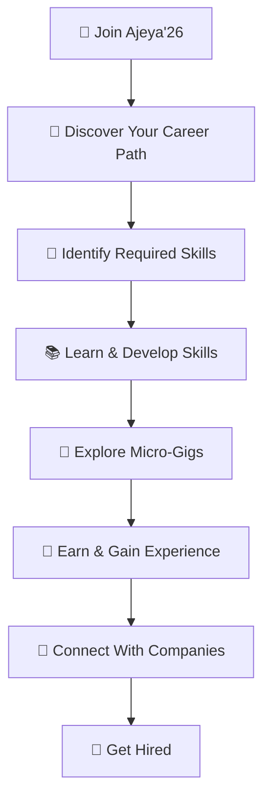

# 🚀 Ajeya'26
### _Learn Skills. Earn Early. Get Hired._

<p align="center">
  
  
  
</p>

<p align="center">
  <strong>A smarter way to turn skills into opportunities.</strong>
  <br/>
  Discover what to learn, earn through meaningful gigs, and connect with companies looking for talent.
</p>

<p align="center">
  <a href="YOUR-LIVE-WEBSITE-URL">🌐 Live Website</a> •
  <a href="#-features">✨ Features</a> •
  <a href="#-our-vision">🎯 Our Vision</a>
</p>

---

## 🌌 The Problem We're Solving

The journey from learning a skill to landing a job isn't always easy.

Students struggle to identify the right skills. Freshers lack practical experience. Teenagers want to earn early but often don't know where to begin. Meanwhile, companies are constantly searching for capable talent.

**What if one platform could connect all these dots?**

Introducing **Ajeya'26** — a platform designed to bridge the gap between learning, earning, and employment.

---

## 💡 What is Ajeya'26?

Ajeya'26 is a career development and micro-gig platform that empowers individuals to build their future while creating opportunities to earn.

From personalized skill guidance to small-scale earning opportunities and company hiring, Ajeya'26 brings the entire career journey into one ecosystem.

> Your career shouldn't begin only after graduation. It should begin the moment you start building your skills.

---

## ✨ Features That Make Us Different

<table>
<tr>
<td width="50%">

### 🎯 Skill Discovery
Discover the skills required for your dream job.

- Industry-relevant skill recommendations
- Career-oriented learning paths
- Job readiness insights

</td>
<td width="50%">

### 💸 Early Earning Opportunities
Start earning through small-scale gigs.

- Micro-tasks for students
- Beginner-friendly opportunities
- Real-world practical experience

</td>
</tr>
<tr>
<td width="50%">

### 🏢 Company Hiring
A dedicated space for companies to find talent.

- Discover skilled individuals
- Post job opportunities
- Connect with potential employees

</td>
<td width="50%">

### 📈 Career Growth
Build your experience before your first full-time job.

- Develop practical skills
- Build a professional portfolio
- Improve employability

</td>
</tr>
</table>

---

## 🔄 How Ajeya'26 Works



**Learn → Build → Earn → Grow → Get Hired**

---

## 👥 Built For Everyone

| 🎓 Students & Teenagers | 💼 Job Seekers | 🏢 Companies |
|---|---|---|
| Earn through small gigs | Discover career paths | Find skilled talent |
| Gain early experience | Build professional portfolios | Hire potential employees |
| Develop useful skills | Improve job readiness | Connect with candidates |

---

## 🎯 Our Vision

We envision a future where opportunities are not limited by age, experience, or background.

A future where students can earn while learning, freshers can gain experience before their first job, and companies can discover talent beyond traditional recruitment.

Ajeya'26 is more than a career platform.

**It's a step towards making opportunities accessible to everyone.**

---

## 🛠️ Tech Stack

<p>
  
  
  
  
  
</p>

> Update the technologies above to reflect the actual tools used in the project.

---

## 🚀 Getting Started

Get Ajeya'26 running on your local machine.

```bash
# Clone the repository
git clone https://github.com/YOUR-USERNAME/Ajeya-26.git

# Navigate to the project
cd Ajeya-26
```

Open the project in **Visual Studio Code** and launch `index.html` using Live Server.

---

## 🔮 What's Next?

Our vision for Ajeya'26 continues to grow.

- 🤖 AI-powered career recommendations
- 📚 Personalized learning roadmaps
- 🧾 Smart resume builder
- 🔐 Verified company profiles
- 💳 Secure gig payment integration
- ⭐ Ratings and reviews
- 🎓 Internship and apprenticeship opportunities
- 🧩 Skill-based job matching

---

## 🤝 Join the Movement

We believe the next generation deserves better opportunities.

Whether you're a student, a developer, a company, or someone who believes in our mission — Ajeya'26 welcomes you.

If you like our vision, consider giving this repository a ⭐.

---

<p align="center">
  <strong>🚀 AJEYA'26</strong>
  <br/>
  <em>Learn Skills. Earn Early. Get Hired.</em>
  <br/><br/>
  Made with ❤️ for the next generation.
</p>
